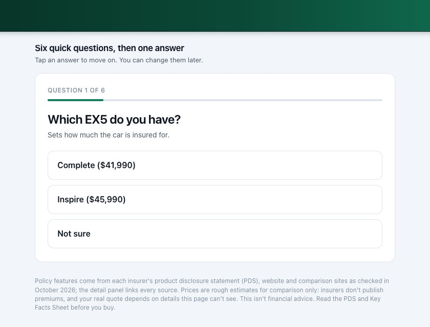
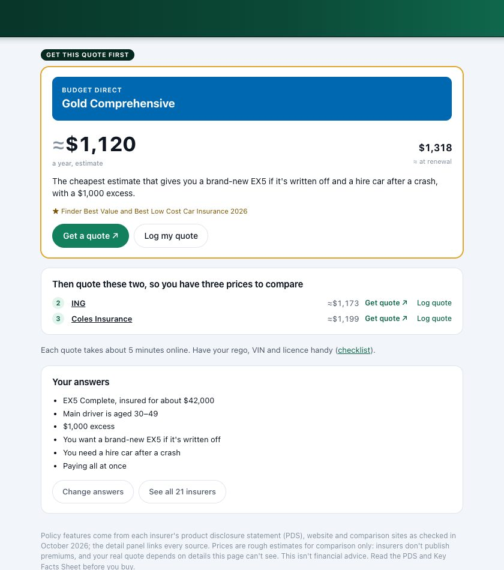

# Fender Bender Chooser

**Live: https://brendonlow.github.io/fender-bender/**

Compare comprehensive car insurance for a **Geely EX5** in Sydney, and keep track of the real quotes you get. It's set up for a car garaged in the Hills District (NSW 2155), using policy details checked in October 2026.

Answer six quick questions and it tells you which insurer to get a quote from first, plus two backups, so you end up with three real prices to compare.

| The questions | Your answer |
|---|---|
|  |  |

## How it works

1. **Six questions:** which EX5 you have, the main driver's age, what you could pay after a crash (your excess), whether you want a brand-new EX5 if it's written off, whether you need a hire car after a crash, and yearly or monthly payment.
2. **One answer:** the cheapest insurer that gives you what you asked for, with its estimated yearly price and likely renewal price, a plain-English reason, and a **Get a quote** button. Two backups sit underneath.
3. **Log your real quotes:** once you have prices, the app says *"Go with X at $Y"*, and suggests who to quote next if someone could still come in cheaper. Quotes are saved only in your browser.

You can change your answers any time, see all 21 insurers, or tap any insurer for the full cover breakdown and sources. **Tips** covers what an EX5 should cost to insure, why Geely's included roadside makes the insurer add-on redundant, agreed vs market value, how to get the price down, and green slips.

| Policy detail | Mobile |
|---|---|
|  |  |

## How good are the numbers?

- **Cover features** come from each insurer's product disclosure statement (PDS), website and comparison sites (CHOICE, Canstar, Finder, Mozo). Every policy's detail panel links its sources. Where a site blocked access or said nothing, the item is marked *not confirmed* rather than guessed, and insurers on CHOICE's 2026 "policies to avoid" list are left off the shortlist.
- **Prices are estimates.** Insurers don't publish premiums, so the model starts from published EX5 evidence: CHOICE's new-Geely average of $1,622, Youi's EX5 range of $1,082–$1,978, Drive's Sydney quote of about $1,904, and NRMA's own EX5 quote of about $2,237. It then adjusts for rough profile rules and each brand's relative pricing. Use the estimates to choose who to ask for a quote first; your real quotes are what count.
- **Claims:** Australia has no public claims-acceptance data for car insurance. The app shows CHOICE's 2025 claims-satisfaction survey where a brand was included.

Not financial advice. Read the PDS and Key Facts Sheet before buying.

## Run it

It's a static site with no build step. Open `index.html`, or run `python3 serve.py 8100` and go to http://localhost:8100.

Sibling apps: [Vroom Vroom Chooser](https://brendonlow.github.io/vroom-vroom/) (pick an EV) and [Protect Lab](https://brendonlow.github.io/protect-lab/) (paint protection for the EX5).
