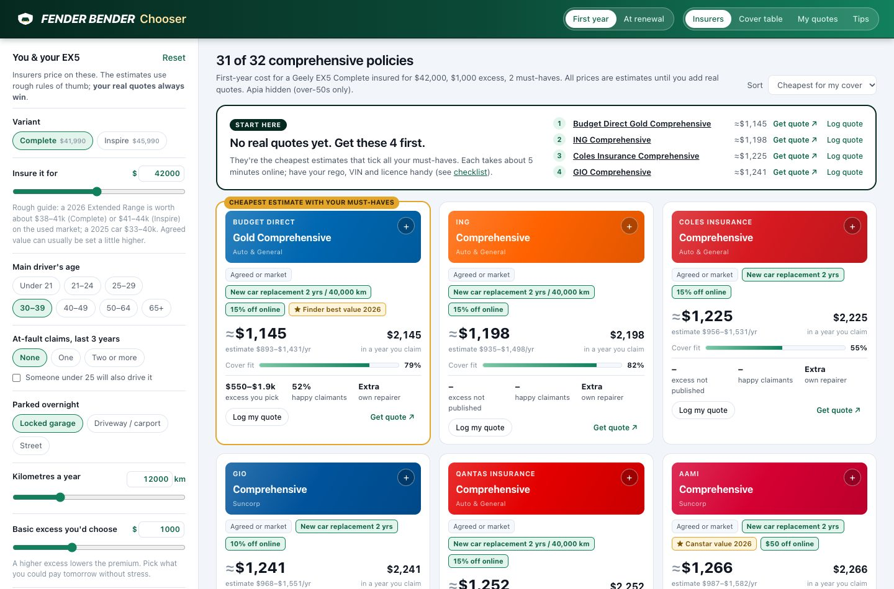
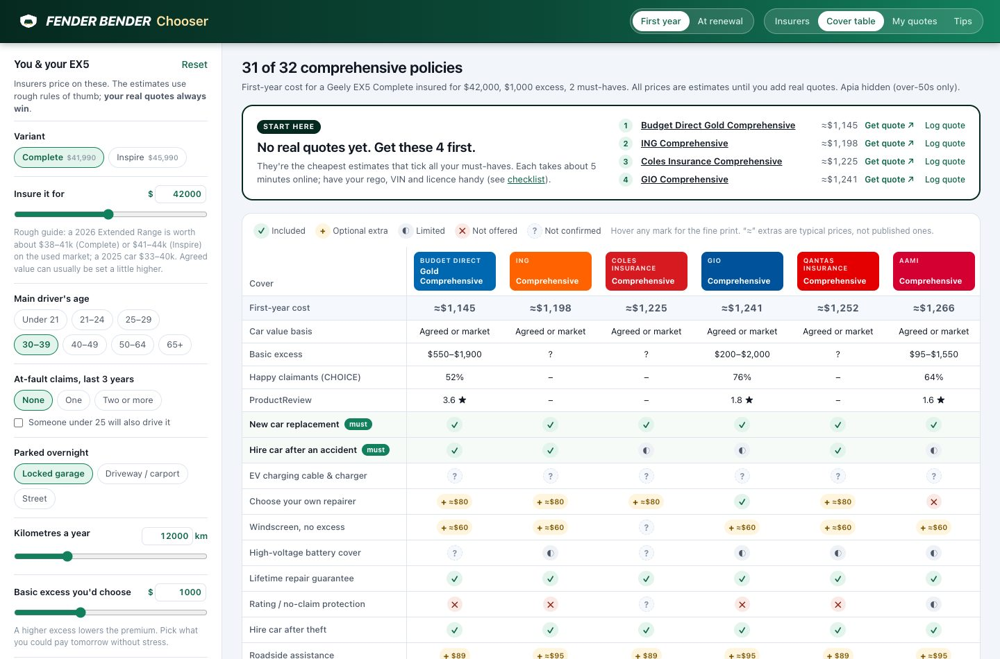
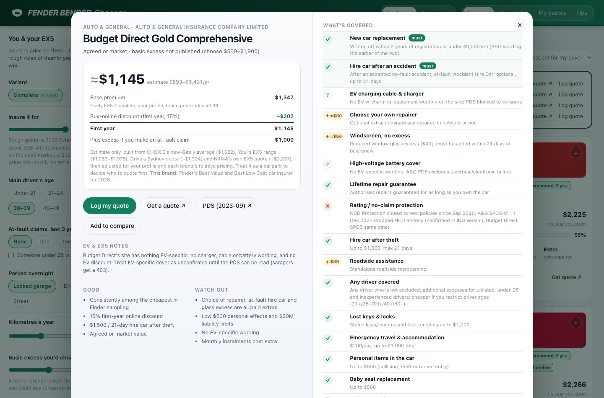
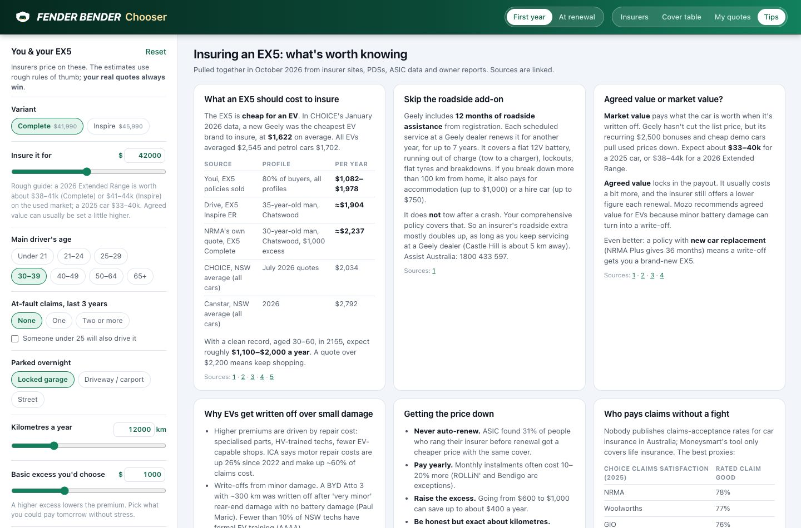
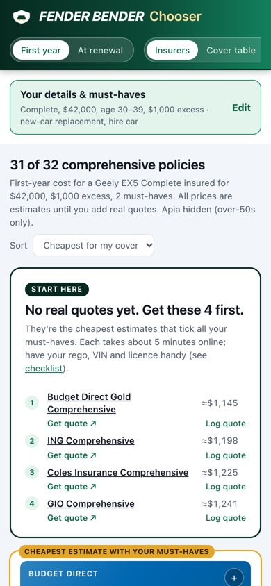

# Fender Bender Chooser

**Live: https://brendonlow.github.io/fender-bender/**

Compare comprehensive car insurance for a **Geely EX5** in Sydney, and keep track of the real quotes you get. It's set up for a car garaged in the Hills District (NSW 2155), using policy details checked in October 2026.

## What it does

- **Insurers.** 32 comprehensive policies from 25 brands, including NRMA, AAMI, GIO, Suncorp, Allianz, Youi, Budget Direct, ROLLiN', ING, Qantas, Coles and Bingle. Each gets an estimated yearly cost for your profile: variant, insured value, age, at-fault claims, parking, kilometres, excess, monthly or yearly payment, and bundling. You also see the cost in a year you make a claim, and how well the policy matches your must-have cover.
- **Must-haves.** Tick the cover you need, such as new-car replacement, a hire car after an accident, EV charger cover or choice of repairer. If a policy only sells it as an extra, the typical cost is added. If it isn't offered, or the policy documents don't confirm it, the policy is flagged.
- **First year vs renewal.** The price once one-off buy-online discounts drop off.
- **Cover table.** Every policy against 17 cover items. Hover a mark to read what the policy document (PDS) actually says.
- **My quotes.** Log the real quotes you get. They replace the estimates everywhere, and the banner shows your best quote and which policies might still beat it. Includes a checklist of what to have ready and questions to ask each insurer. Quotes are saved only in your browser.
- **Tips.** What an EX5 should cost to insure, why Geely's included roadside makes the insurer add-on redundant, agreed vs market value, why EVs get written off after small damage, green slip prices, and who handles claims well.

| Policy detail | Tips | Mobile |
|---|---|---|
|  |  |  |

## How good are the numbers?

- **Cover features** come from each insurer's product disclosure statement (PDS), website and comparison sites (CHOICE, Canstar, Finder, Mozo). Every policy's detail panel links its sources. Where a site blocked access or said nothing, the item is marked *not confirmed* rather than guessed.
- **Prices are estimates.** Insurers don't publish premiums, so the model starts from published EX5 evidence: CHOICE's new-Geely average of $1,622, Youi's EX5 range of $1,082–$1,978, Drive's Sydney quote of about $1,904, and NRMA's own EX5 quote of about $2,237. It then adjusts for rough profile rules and each brand's relative pricing. Use the estimates to choose who to ask for a quote first; your real quotes are what count.
- **Claims:** Australia has no public claims-acceptance data for car insurance. The app shows CHOICE's 2025 claims-satisfaction survey where a brand was included.

Not financial advice. Read the PDS and Key Facts Sheet before buying.

## Run it

It's a static site with no build step. Open `index.html`, or run `python3 serve.py 8100` and go to http://localhost:8100.

Sibling apps: [Vroom Vroom Chooser](https://brendonlow.github.io/vroom-vroom/) (pick an EV) and [Protect Lab](https://brendonlow.github.io/protect-lab/) (paint protection for the EX5).
